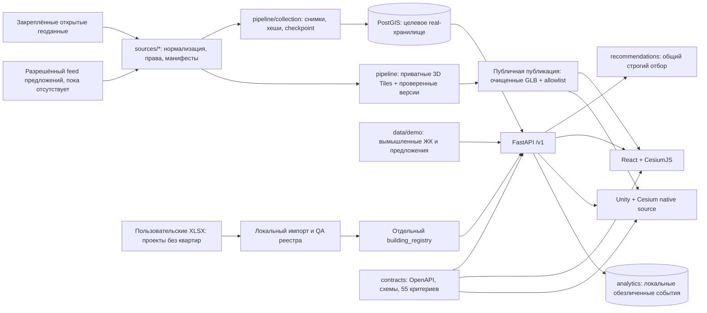

# Архитектура проверяемого прототипа

`backend/store.py` выбирает **один** режим данных при загрузке: локальный
`demo`-каталог либо PostGIS `real`. В `real` отсутствие разрешённого feed
оставляет текущие предложения пустыми; вымышленные цены туда не подставляются.
Проверенный локальный импорт пользовательских XLSX включается в отдельный
`building_registry`, а `/v1/health.catalog_view` переключает главный веб-вид
на его список. Реестр хранит объекты, адреса и статусы без квартир, цен и
наличия. Он не изменяет каталог предложений; права исходных XLSX обозначены
`user_supplied_internal_use`, не открытой лицензией. Маркер на карте появляется
только у записи с подтверждёнными координатами; наличие города в 3D Tiles само
по себе не связывает footprint с объектом реестра. Native Unity-исходник
показывает явное состояние неподдерживаемого реестра, сохраняя старый demo
сценарий при отдельном выключении реестра.
Для основной карты `/v1/map/points` добавляет отдельные OSM-точки нанесённых
строек к строго привязанным адресным точкам реестра. Два типа имеют разные
opaque цели `candidate_id` и `registry_id`; совпадение координат не создаёт
связь проекта. Маркеры не зависят от страницы списка и не несут URL
индивидуальной 3D-геометрии. Фильтры и права описаны в
[контракте v1.3](../contracts/IMPLEMENTATION-1.3.md).
`recommendations/engine.py` проверяет активность, права, свежесть и жёсткие
условия до ранжирования и лимита. `/v1/map`, `/v1/search`, детали и
рекомендации используют одну политику допустимости. Её машинное описание —
[v1.1 контракт](../contracts/IMPLEMENTATION-1.1.md), [OpenAPI](../contracts/openapi.json)
и [реестр критериев](../contracts/criteria_registry.json). `contracts/build_registry.py`
детерминированно собирает реестр из трёх обработанных матриц.

Геометрия города и предложения имеют разные доказательства и счётчики.
Поток `sources/` → `pipeline/` сохраняет исходный ID, снимок, права и
атрибуцию; 3D-объём здания остаётся синтетическим даже при реальном контуре.
Отдельные `/assets`-слои для города, дорог, парков и воды передаются обоим
клиентам через `Tileset.url`. У текущего города 564 031 родительский контур;
проверенные 800 ступенчатых частей 166 родителей из 29 714 частей у 6263
родителей изменяют только форму отображения, а не этот счётчик или факты о
квартирах. Для точной OSM ID и версии `height` у выбранной части означает
верхнюю отметку от земли, `min_height` — нижнюю отметку; интервал рендера
`[min_height или 0, height]`, а `roof:height` не прибавляется. Это правило
не переносится на другой источник без проверки [поля и версии](briefs/city-height-parts.md).
Данные о квартире, секции или этаже не выводятся из внешней оболочки.
Активный плоский `public-ground-v3` — самостоятельный 3D Tiles набор из исходных
Building-полигонов: общий дальний raster overview, 212 упрощённых региональных
векторных GLB и 3396 точных ячеек без упрощения, включая отверстия и
MultiPolygon. Ячейки поднимаются на +0,45 м над WGS84; исправленные дороги
`public-roads-v2`, парки и вода имеют собственные постоянные tilesets. Отдельный
`public-citywide-v10` содержит 212 обзорных GLB из индивидуальных footprint-призм
без сплошных coarse-ячеек и прежние 3396 детальных GLB v8, с 212 внешними
региональными JSON. Координаты и порядок каждого треугольника обзора совпадают
с v9; нормали и lit-материал согласованы с деталями. Замена LOD 3D не удаляет
плоский ground.
Веб-клиент запрашивает city/facade `fromUrl` только после точного видимого
ground region/cell (`tileVisible`, GE ≤2 м), двух `postRender` при неизменном
виде и двух здоровых окон активной пробы кадров. Корни дорог/парков/воды к
этому моменту разрешены, их детальная загрузка не держит барьер. Ground
использует skip-LOD без соседей, чтобы общий raster parent не вызывал запрос
всех 212 регионов. Объёмы не удаляются из кэша при движении; city включается
при ≤12 км и скрывается при ≥16 км. Адаптивный рендер повышает детализацию
SSE 128 → 64 → 24 только при подтверждённом запасе по времени кадров и
понижает её при просадке. Это проверено по коду и pure unit tests; новый
браузерный FPS в текущем sandbox не получен.

Независимый [offline-аудит](../integration/audit_ground_city.py) проверил 564 031
source-to-cell count, 995 отверстий, 702 MultiPolygon, высоту ячеек и
положительную высоту дальнего overview между вершинами, ссылки/границы/очистку
и геометрический baseline city-v8. [Аудит city-v9](../integration/audit_footprint_city.py)
проверил все 212 индивидуальных обзорных GLB, высоты, приватность и 3396
побайтно неизменённых деталей. [Аудит city-v10](../integration/audit_city_lighting.py)
проверил точные индексированные треугольники, нормали, материалы, 3396 деталей
и приватность; [аудиты дорог](../integration/audit_road_seams.py) и
[их границ](../integration/audit_road_bounds.py) проверили стыки и bounds
всех публичных GLB roads-v2. [Две WKB-выборки](../integration/audit_ground_source_samples.py)
сверены с публичными GLB baseline v2. В активном v3 исправлены только линейные факторы glTF-материала: после linear→sRGB они дают ту же палитру #AAAFB2, что и PNG. [Цветовой аудит](../integration/audit_ground_color.py) подтвердил неизменность BIN всех 3608 векторных GLB относительно v2. [Top-down preview](../.runtime/ground-preview/ground-map.png)
рисует фактические GLB и картографические линии без Cesium; это не снимок
работающего веб-приложения.
[Покрытие данных](../contracts/DATA-COVERAGE.md) разделяет
вымышленные предложения, текущие реальные предложения и городскую геометрию.

`backend/public.py` сохраняет происхождение полей внутри сервера и по
умолчанию скрывает идентичность поставщиков на всех публичных маршрутах.
Только серверная настройка при запуске может раскрыть внутренние источники;
клиентский запрос не может. Обязательная авторская подпись картографического
слоя выводится всегда. `/v1/metrics` считает только ограниченные UI-события;
сегодня это в том числе трафик автопроверок, не продажи и не метрики реальных
покупателей. Вкладка «Данные» использует отдельный `/v1/data-coverage`.

Публикация тайлов отделяет внутренние источники и индексы от HTTP. Текущие
`public-ground-v3`/`public-citywide-v10` и три публичных картографических набора
удаляют внутренние source ID и сохраняют обязательную атрибуцию. Backend
выдаёт активные очищенные корни и совместимые `public-citywide-v4`–`v9` и `public-roads-v1`
для уже открытых клиентов. Проверенный ground-v2 сохранён для совместимости, неопубликованный ground-v1 заблокирован;
внутренние манифесты, индексы и исходные GLB недоступны по `/assets`.
Версионированные внешние `region_<x>_<y>.tileset.json` доступны только внутри
разрешённых публичных корней. Исходные атрибуты и карты ID остаются локальными
для воспроизведения и правовой проверки.

Локальный пешеходный граф и семь маршрутов между проверенными точками доступа
POI показывают работоспособность офлайн-роутера. Они не подтверждают маршруты
от входов ЖК, охват всех категорий или транспортные пересадки; соответствующие
buyer-facing факты и индекс остаются неизвестными.

Контракт проверяется `integration/check_live.py` на работающем API,
`integration/run_acceptance.py` исполняет 100 сценариев, а клиентские проверки
запускаются командами из [README](../README.md). Управляемый локальный
production-preview стартует через `scripts/dev.py`; он не является
публикацией сервиса. Нативный исходный проект требует отдельной сборки в
Unity Editor, а iOS — macOS/Xcode/подписи.
